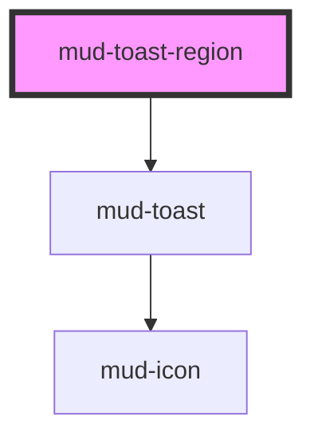

# mud-toast-region

<!-- Auto Generated Below -->

## Overview

Toast region — places, stacks and dismisses `mud-toast` messages the way the
Figma "Toast Message" page shows them (14830:13653).

- Placement: top-right, 32px from the edges, on screens wider than 640px;
  at the bottom, 8px from the sides and 12px from the bottom, below that.
- Stacking: 12px apart. On desktop the newest toast is on top; on mobile the
  newest is nearest the bottom and pushes older ones up.
- Dismissal: an `info` or `success` toast with no action closes itself after
  `duration` (the timer pauses while the pointer is over the region or focus
  is inside it); a warning, an error or a toast with an action stays until
  the user closes it. A closed toast is removed from the region.

Put one region on the page and add toasts with `show()`, or append
`<mud-toast>` children to it yourself. Each toast keeps its own live-region
role, so it is announced as it appears; the region is a labelled landmark
while it holds toasts.

## Properties

| Property   | Attribute  | Description                                                                                                                                | Type                                                        | Default     |
| ---------- | ---------- | ------------------------------------------------------------------------------------------------------------------------------------------ | ----------------------------------------------------------- | ----------- |
| `duration` | `duration` | Milliseconds an `info` or `success` toast with no action stays before it closes itself. `0` keeps every toast until the user closes it.    | `number`                                                    | `5000`      |
| `label`    | `label`    | Accessible name of the notifications landmark. Overrides the `locale`'s copy when set to a non-empty string.                               | `string \| undefined`                                       | `undefined` |
| `locale`   | `locale`   | Language of the region's accessible name. Unset, the component follows the closest ancestor `lang` (`<html lang>` included), else `ro-MD`. | `"en-US" \| "ro-MD" \| "ru-MD" \| string & {} \| undefined` | `undefined` |

## Methods

### `show(options: ToastRegionShowOptions) => Promise<HTMLMudToastElement>`

Adds a toast built from `options` and returns it, so actions can be slotted
into it. The message is set as text, never parsed as HTML.

#### Parameters

| Name      | Type                     | Description |
| --------- | ------------------------ | ----------- |
| `options` | `ToastRegionShowOptions` |             |

#### Returns

Type: `Promise<HTMLMudToastElement>`

## Slots

| Slot | Description                             |
| ---- | --------------------------------------- |
|      | The `mud-toast` elements, oldest first. |

## Dependencies

### Depends on

- [mud-toast](../mud-toast)

### Graph

----------------------------------------------

*Built with [StencilJS](https://stenciljs.com/)*
